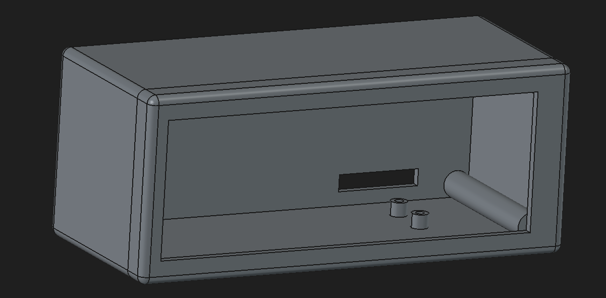

# Spotyink

Spotyink shows your currently playing Spotify track — cover art, title, artist,
play/pause state and playback progress — on a 5.79" E-Ink display, driven by an
ESP32-C6. It comminucates with Spotify via the Web API using a self-registered app.


## Features

- Album cover, title, artist(s), play/pause icon and a progress bar with elapsed/total time
- Runs entirely on-device, no server/bridge required besides Spotify's API
- Refresh token handling so the device stays authorized without repeated logins

## Hardware

- Controller: ESP32-C6 ([product page](https://www.espressif.com/en/products/socs/esp32-c6))
- Display: Waveshare E-Ink 5.79" ([product page](https://www.waveshare.com/5.79inch-e-paper-module.htm))
- Some smaller electronic components: copper PCB and pin headers

A 3D-printable case is included as a FreeCAD file at [`doc/Housing.FCStd`](doc/Housing.FCStd).    

## Pin configuration

| Display pin | ESP32 pin |
| ----------- | --------- |
| PWR         | GPIO 11   |
| BUSY        | GPIO 2    |
| RST         | GPIO 3    |
| DC          | GPIO 10   |
| CS          | GPIO 7    |
| CLK         | GPIO 6    |
| DIN         | GPIO 5    |
| GND         | GND       |
| VCC         | 3.3V      |


## Installation

This project uses [PlatformIO](https://platformio.org/), which is highly recommended for building and flashing.

1. **Register a Spotify app**
   Create one at the [Spotify Developer Dashboard](https://developer.spotify.com/dashboard).
   The redirect URI must point to `localhost`, e.g. `http://127.0.0.1:8000/callback`.

2. **Fetch an initial refresh token**
   Run the helper script in `tools/fetch_first_refresh_token`:
   ```
   cd tools/fetch_first_refresh_token
   python fetch_refresh_token.py
   ```
   This walks you through the Spotify OAuth flow and prints a refresh token.

3. **Seed the refresh token onto the ESP32**
   The ESP32 needs the token stored in permanent memory before it can use the
   Spotify API on its own. Flash and run the seeding helper:
   ```
   cd tools/seed_refresh_token/src
   pio run -t upload -t monitor
   ```
   Follow the on-screen instructions, paste the refresh token, and press enter.

4. **Configure your credentials**
   Copy `include/secrets.example.h` to `include/secrets.h` and fill in your
   WiFi and Spotify app credentials:
   ```
   cp include/secrets.example.h include/secrets.h
   ```
   ```c
   #define WIFI_SSID "your-wifi-name"
   #define WIFI_PASSWORD "your-wifi-password"

   #define SPOTIFY_CLIENT_ID "your-spotify-client-id"
   #define SPOTIFY_CLIENT_SECRET "your-spotify-client-secret"
   #define SPOTIFY_REDIRECT_URI "http://127.0.0.1:8000/callback"
   ```
   `secrets.h` is git-ignored, so your credentials never get committed.

5. **Flash the main project**
   ```
   pio run -t upload
   ```

## Usage

Plug the ESP32 into a power source and start playing something on Spotify.
The first screen update can take up to 30 seconds — after that it should look
like the screenshot above.


## Further work
Currently a kind of button is in progress to control the current playback.  
E.g. skip song, previous song, pause, play...

